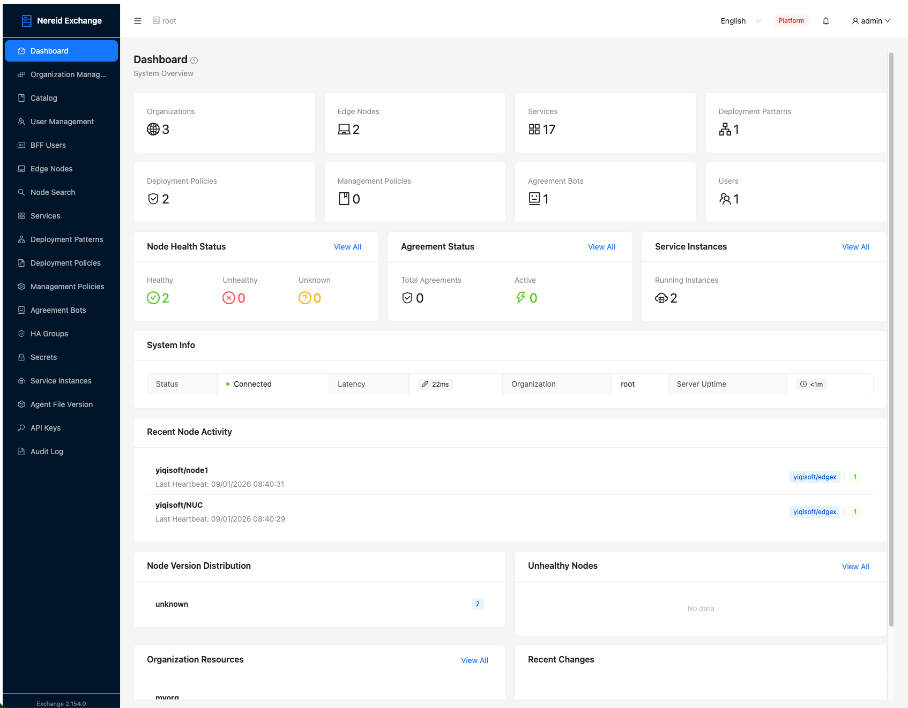

# Nereid Exchange UI (NereidAI)

[](https://github.com/NereidAI/Open-Horizon-ExchangeUI/actions/workflows/ci.yml)
[](LICENSE)
[](https://github.com/NereidAI/Open-Horizon-ExchangeUI/pkgs/container/open-horizon-exchangeui-backend)

Nereid Exchange UI is a modern, lightweight Web Management Portal and BFF (Backend-For-Frontend) proxy gateway designed specifically for the **Open Horizon Management Hub**.

It provides an intuitive visual interface to simplify the service lifecycle and edge resource management in Open Horizon. With NereidAI, operators can seamlessly manage edge nodes, service definitions, deployment patterns, deployment policies, management policies, Agreement Bots (AgBots), and High Availability (HA) node groups.



---

## 🚀 Key Features

1. **Modern Management Interface**
   - Built with **React 18**, **Vite 5**, and **Ant Design 5 (antd)** for a sleek, responsive, and interactive user experience.
   - Built-in multi-lingual support, fully localized in **English** and **Simplified Chinese (`zh-CN`)**.

2. **Secure Session Authentication (production-grade)**
   - Exchange credentials are **never stored in the browser** and **never persisted in plaintext** on the server.
   - On login, the BFF verifies the Exchange credentials, encrypts them with **AES-256-GCM** (server-side master key), and persists them in **Redis** with a 30-minute idle TTL.
   - The browser only holds an opaque `sessionId` in an **HttpOnly + Secure + SameSite=Strict** cookie (inaccessible to JavaScript, not sent cross-site).
   - Idle sessions expire automatically; logout destroys the session and clears the cookie.

3. **Automated Deployment Signing & Key Management**
   - When creating or updating service definitions, the BFF proxy **automatically signs deployment configurations** using the RSA-PSS SHA-256 algorithm.
   - Automatically uploads the corresponding public key to the Exchange (`services/{id}/keys/default.public.key`), eliminating manual cryptographic signing steps.

4. **Interactive JSON Importers**
   - Seamlessly import services, deployment patterns, deployment policies, and management policies via JSON files.
   - Automatically detects template variables (e.g., `$HZN_ORG_ID`, `$SERVICE_NAME`, `$SERVICE_VERSION`) and offers an interactive UI to replace them in real-time.

5. **Cross-Organization Support**
   - Browse public services and patterns across different organizations.
   - Supports special headers (like `X-Root-Auth` and `X-Agbot-Auth`) for administrative tasks and high-privilege operations.

6. **HA Node Groups**
   - Configure, manage, and monitor High Availability groups, node memberships, and network configurations.

7. **Audit & System Logging**
   - All API requests, Exchange calls, login/logout events, and node-registration detections are written to `system.log` and `audit.log`.
   - The **Audit Log** page provides a searchable, expandable view of both logs.

8. **TLS & Hardened Headers**
   - The Nginx front end terminates **HTTPS (TLS 1.2/1.3)**; plain HTTP is redirected to HTTPS.
   - Ships with HSTS, `X-Frame-Options: DENY`, CSP, `Referrer-Policy`, and other security response headers.

---

## 🛠️ Tech Stack

- **Frontend**: React 18, Vite 5, React Router v6, Ant Design v5, TypeScript
- **Backend (BFF Proxy)**: Express 5, Node.js (Crypto API), ioredis (Redis client)
- **Session Store**: Redis (optional; falls back to in-memory), AES-256-GCM encrypted credentials at rest
- **Deployment**: Docker & Docker Compose, Nginx (TLS reverse proxy)

---

## 📁 Project Structure

```text
NereidAI/
├── src/                    # Frontend React Source Code
│   ├── api/                # API Request Layer (calling BFF APIs)
│   │   ├── config.ts       # In-memory UI session state (no credentials)
│   │   ├── client.ts       # Fetch wrapper (cookie-based auth)
│   │   └── *.ts            # Per-resource API clients
│   ├── components/         # Common UI Components and AppLayout
│   ├── i18n/               # Multi-lingual translations (zh.ts, context)
│   ├── pages/              # UI Page Modules (Dashboard, Nodes, Services, Agbots, etc.)
│   ├── App.tsx             # Route config, providers, session bootstrap
│   └── main.tsx            # React application mount entrypoint
├── server/                 # BFF Proxy Server (Express)
│   ├── index.cjs           # Backend entrypoint (routes, auth, Redis session, proxying)
│   └── sign-utils.cjs      # Cryptographic utils (RSA-PSS SHA-256 generator/signer)
├── docker/
│   ├── nginx-entrypoint.sh # Generates self-signed TLS cert if none is mounted
│   └── nginx.dev.conf      # Nginx config for the local docker-dev-* stack
├── deploy/                 # Open Horizon Hub & Agbot Deployment Templates
├── docs/                   # Documentation and API specs (openapi.yaml)
├── nginx.conf              # Nginx TLS + reverse-proxy + security headers
├── Dockerfile              # Multi-stage: backend runtime + nginx frontend
├── docker-compose.yaml     # Production compose (ghcr.io images, redis + postgres)
├── docker-compose.dev.yaml # Isolated local-build dev stack (project "nereid-dev")
├── Makefile                # Build, dev, docker helpers
├── scripts/                # Offline image export/load helpers
├── .github/                # CI (ci.yml), publish (publish.yml), dependabot, templates
├── LICENSE                 # Apache License 2.0
├── NOTICE                  # Third-party attribution
├── SECURITY.md             # Vulnerability reporting + security model
├── CONTRIBUTING.md         # Contribution guidelines
├── CODE_OF_CONDUCT.md      # Community standards
├── .env.example            # Backend environment template
└── package.json            # Node.js dependencies and scripts
```

---

## 🚦 Getting Started (Local Development)

> For full installation details — environment variables, PostgreSQL setup, Exchange configuration, and first-time setup — see **[INSTALL.md](INSTALL.md)**.

### 1. Install Dependencies

```bash
npm install
```

### 2. Run the Development Servers

Use `make dev-all` to start the whole stack (PostgreSQL container + backend + frontend) with one command. It is idempotent and **kills any existing dev servers** before starting, so re-running it is safe:

```bash
make dev-all
```

Or start each piece individually:

*   **Start BFF Proxy Server**:
    ```bash
    make dev-backend   # or: npm run dev:backend
    ```
    Listens on `http://localhost:3001`. Requires `DATABASE_URL` (PostgreSQL) and optionally Redis. See [INSTALL.md](INSTALL.md) for environment variable reference.

*   **Start Vite Frontend**:
    ```bash
    make dev-frontend   # or: npm run dev
    ```
    Frontend requests to `/api/*` are proxied to the BFF at `http://localhost:3001`.

Stop everything with `make dev-stop` (keeps the dev database) or `make dev-clean` (also removes build artifacts and the dev database).

> **Note**: In production the front end is served by Nginx over HTTPS (see Docker Deployment). Local dev uses plain HTTP and the browser dev server.

---

## 🐳 Docker Deployment

The project ships a multi-stage `Dockerfile` and two Compose files. Choose your mode:

| Mode | Command | Images |
|---|---|---|
| **Production** (pull) | `make docker-up` | Pulls from `ghcr.io/nereidai/*` |
| **Development** (build) | `make docker-dev-up` | Builds locally from source |

> The `docker-dev-*` stack is **fully isolated** from production: it runs under a
> separate Compose project (`nereid-dev`), uses its own containers (`*-dev` suffix),
> its own volumes, and its own postgres (`127.0.0.1:5434`) — so `docker-dev-up` and
> `docker-up` can run side by side without colliding, including their databases.

Services (production compose):

| Service | Image | Purpose | Port |
|---|---|---|---|
| `redis` | `redis:6.2.2-alpine` | Encrypted session store (TTL, optional) | internal |
| `postgres` | `postgres:16-alpine` | Database for BFF (audit, settings, users) | internal |
| `open-horizon-exchangeui-backend` | ghcr or local | BFF API proxy | `3001` (internal) |
| `open-horizon-exchangeui-frontend` | ghcr or local | Nginx + static assets + TLS | `8090` (HTTP→HTTPS), `8443` (HTTPS) |

Dev stack (`docker-dev-*`): the frontend is served over plain HTTP on `8091`, and
postgres is exposed on `127.0.0.1:5434`; the backend/redis keep default internal
ports, so neither collides with production.

### Build & Launch

**Local build (development)**:
```bash
make docker-dev-up
```

**Pull from GHCR (production)**:
```bash
make docker-up
```

- Open **https://&lt;host&gt;:8443/** (HTTP on `8090` redirects to HTTPS).
- For the local `docker-dev-*` stack, open **http://&lt;host&gt;:8091/** (plain HTTP, no TLS).
- The first launch auto-generates a self-signed certificate at `/etc/nginx/ssl`. For production, mount real certificates there instead (see below).
- First-time start requires visiting the UI to complete the **Setup** form (create admin account + Exchange connection). The Setup form includes a **random strong-password generator** and **confirm-password** validation. See **[INSTALL.md § First-time Exchange configuration](INSTALL.md#4-first-time-exchange-configuration-setup-form)** for details.

### Backend Environment Variables

| Variable | Default | Description |
|---|---|---|
| `PORT` | `3001` | BFF listen port |
| `REDIS_URL` | `redis://redis:6379` | Redis connection string |
| `SESSION_TTL` | `1800` | Session idle lifetime in seconds (30 min) |
| `SESSION_ENC_KEY` | _(auto-generated)_ | 32-byte master key as 64 hex chars for AES-256-GCM. Override in production to persist across restarts. |

---

## 🔒 Security Model (for Audit)

- **Credential confidentiality**: Exchange `Basic` credentials are encrypted with **AES-256-GCM** (`server/index.cjs`) using a server-side master key before being written to Redis. Redis never stores plaintext credentials. The master key file (`/app/.session.key`) is created with `0600` permissions.
- **Browser attack surface**: The session identifier is an opaque random token in an `HttpOnly; Secure; SameSite=Strict` cookie. It is unreadable by JavaScript (XSS-resistant) and not attached to cross-site requests (CSRF-resistant).
- **Transport security**: All browser traffic is served over HTTPS (TLS 1.2/1.3). HTTP is redirected to HTTPS. HSTS is enabled.
- **Session lifetime**: 30-minute idle timeout enforced by Redis TTL plus an in-memory sweeper. Logout immediately invalidates the session and clears the cookie.
- **Input safety**: Request bodies are filtered through strict field whitelists (`serviceBody`, `patternBody`, `sanitizeBody`) to prevent payload pollution.
- **Auditability**: Every API call, Exchange call, and auth event (login/logout/node_register) is recorded with timestamp, user, method, path, status, and duration in `system.log` / `audit.log`.
- **Graceful degradation**: If Redis is unreachable, the BFF falls back to an in-memory encrypted store (single-instance only).

---

## 🏭 Offline / Air-Gapped Production Deployment

This project is designed to run **without internet access** in production.

1. **Build and export images on a connected machine**:
   ```bash
   make images-export
   ```
   (Equivalent to `docker compose build` + `docker save` of
   `open-horizon-exchangeui-backend`, `open-horizon-exchangeui-frontend`,
   and `redis:6.2.2-alpine` into `nereid-images.tar`.)
2. **Transfer** `nereid-images.tar` to the production host and load:
   ```bash
   make images-load
   ```
3. **Start** with Compose:
   ```bash
   docker compose up -d
   ```
   No `npm install` or image pull occurs at runtime — all dependencies are baked into the images via the offline `Dockerfile` (`COPY node_modules`).

### Production hardening checklist

- **TLS certificate**: Mount a CA-signed certificate/key to `/etc/nginx/ssl/fullchain.pem` and `/etc/nginx/ssl/privkey.pem` (bind mount or volume) so the self-signed cert is not used.
- **Session master key**: Set `SESSION_ENC_KEY` (64 hex chars) via an environment file/secret so the key persists across container recreation and is not auto-generated per host.
- **Persist Redis data**: The `redis-data` named volume is already declared; keep it to retain session store across restarts.
- **Reverse proxy**: Place the container stack behind your corporate TLS-terminating ingress if preferred; the built-in Nginx TLS is sufficient for direct exposure.

---

## 📦 Container Images (GHCR)

Prebuilt multi-arch (`amd64`, `arm64`) images are published to GitHub Container Registry on each release:

```bash
docker pull ghcr.io/nereidai/open-horizon-exchangeui-backend:latest
docker pull ghcr.io/nereidai/open-horizon-exchangeui-frontend:latest
```

To run directly from GHCR (production), use `make docker-up` — this pulls the published images. For local development with your source changes, use `make docker-dev-up`, which builds locally via `docker-compose.dev.yaml`. For fully offline/air-gapped deployment, export the images locally with `make images-export` and transfer them (see `docs/PRODUCTION.md`).

---

## 🛠️ Makefile Automations

A `Makefile` is provided to speed up common workflows.

| Command | Description |
|---|---|
| **Local Development (npm)** | |
| `make install` | Install npm packages locally |
| `make build` | Compile and build the React app to `dist/` |
| `make dev-pg` | Start a dedicated PostgreSQL for the BFF (idempotent), writes `.env` |
| `make dev-backend` | Run the backend BFF in development mode (kills any existing one first) |
| `make dev-frontend` | Run the Vite frontend dev server (kills any existing one first) |
| `make dev-all` | (Re)start pg + backend + frontend with one command |
| `make dev-stop` | Stop backend & frontend & the dev database (keeps pg data) |
| `make dev-clean` | Stop everything + remove build artifacts (`dist/`) and the dev database |
| **Docker (ghcr.io images — production)** | |
| `make docker-up` | Pull GHCR images & start production containers |
| `make docker-down` | Stop and remove production containers (keeps data volumes) |
| `make docker-clean` | Stop and remove containers **and** their data volumes |
| `make docker-logs` | Tail production container logs |
| `make docker-ps` | Show production stack status |
| **Docker (local build — development/test, isolated project `nereid-dev`)** | |
| `make docker-dev-build` | Build Docker images from local source |
| `make docker-dev-up` | Build (if needed) & start the local dev stack (isolated from prod) |
| `make docker-dev-down` | Stop the local dev stack (keeps data volumes) |
| `make docker-dev-clean` | Stop the local dev stack **and** remove data volumes |
| `make docker-dev-logs` | Tail local dev stack logs |
| `make docker-dev-ps` | Show local dev stack status |
| `make docker-build` | Alias for `docker-dev-build` |
| **Maintenance** | |
| `make clean` | Delete temporary files, `dist/`, and `node_modules/` |

---

## 🤝 Repository & Community

- **Source**: https://github.com/NereidAI/Open-Horizon-ExchangeUI
- **Contributing**: see [CONTRIBUTING.md](CONTRIBUTING.md)
- **Code of Conduct**: see [CODE_OF_CONDUCT.md](CODE_OF_CONDUCT.md)
- **Security Policy**: see [SECURITY.md](SECURITY.md) (please report vulnerabilities privately)
- **Production Guide**: see [docs/PRODUCTION.md](docs/PRODUCTION.md)
- **Database**: see [docs/DATABASE.md](docs/DATABASE.md) (schema, `DATABASE_URL` setup, troubleshooting)

---

## 📄 License

This project is licensed under the Apache License 2.0. See [LICENSE](LICENSE) and [NOTICE](NOTICE).
